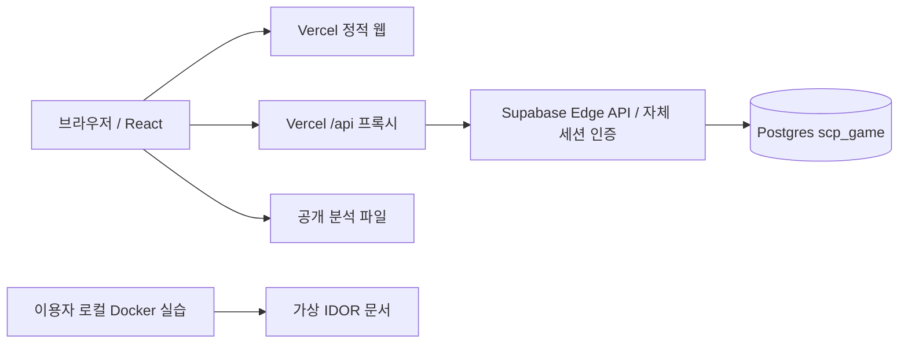

# 아키텍처

## 운영 요청 경로

브라우저 → Vercel 프록시 → Supabase Edge Function → Postgres가 실제 운영 경로입니다. 프록시가 Cookie·Origin을 보존하고 Set-Cookie를 브라우저에 전달하므로 세션은 웹사이트 origin에 저장됩니다. Edge 함수의 service role 키는 Supabase 기본 환경변수에만 있습니다. Vercel에는 비밀이 아닌 함수 URL만 설정합니다.

로컬은 같은 `createHandler`를 Express에서 호출하고 SQLiteRepository를 연결합니다. 운영은 SupabaseRepository를 연결합니다. 둘 다 select/insert/remove/rate/rankings 인터페이스를 구현합니다. 서버 없는 미리보기 데이터로 채점하지 않습니다.

## 모델

- users: UUID, unique codename, bcrypt password_hash, created_at
- sessions: SHA-256 token_hash, user_id, expires_at. 원본 세션 토큰은 쿠키에만 존재합니다.
- chapters: act_id, required_clearance, release_status
- challenges: chapter_id, points, difficulty, release_status
- progress: (user_id, challenge_id) 고유 키와 solved_at
- submissions: 정오 판정과 시각만 저장. 제출 FLAG 원문을 저장하지 않습니다.
- hints: (user_id, challenge_id, level). 단계별 사용 이력을 유지합니다.
- rate_buckets: 키, 횟수, 만료 시각. Postgres upsert로 동시 요청을 직렬화합니다.
- 문서·힌트·스토리·파일 경로는 버전 관리된 서버 카탈로그에 둡니다. Document의 해금 조건은 해당 challenge 해결입니다.

점수와 인가는 progress와 카탈로그로 재계산합니다. 중복 INSERT는 PK 충돌 시 무시되어 추가 점수를 만들지 못합니다. 별도의 가변 점수 필드가 없어 읽기와 쓰기 경쟁으로 누적 점수가 부풀지 않습니다. 챕터는 앞 챕터를 전부 해결해야 열립니다. 보안 인가는 연속 완료한 챕터 수로 산출됩니다. 프론트엔드 값은 권한 결정에 쓰지 않습니다.

Supabase 랭킹 RPC는 서버 전용 SECURITY INVOKER이며 최대 50개 코드명·점수·해결 수·마지막 해결 시각만 반환합니다. 정렬은 점수 DESC, 마지막 해결 시각 ASC NULLS LAST, 코드명 ASC입니다. 동일 점수의 최신 제출이 아니라 마지막 **최초 해결 기록**을 사용합니다. 재제출로 순위를 조작하지 못합니다.

## 경계와 배포

운영 DB와 실습 데이터는 연결되어 있지 않습니다. Docker에는 운영 env, 호스트 폴더, Docker socket을 마운트하지 않습니다. IDOR 서버는 Docker에 포함된 가상 JSON만 조회합니다. 006은 웹에서 임의 서버를 띄우는 기능이 없으며 이용자 로컬 환경에서 실행합니다.

ACT II–IV 카드는 planned 상태입니다. API의 `/challenges/11` 이상은 실제 등록 전 404입니다. 미구현 실습을 완료 표시하지 않습니다.

`backend/schema.sql`은 최초 설치 스키마의 재현 파일입니다. 이미 적용된 DB에는 재실행하지 않습니다. 향후 스키마 변경은 Supabase CLI로 migration 파일을 생성하고 검토 후 적용합니다. 카탈로그의 점수와 DB challenges 점수는 함께 갱신하고 총점 일치 테스트를 유지합니다.

외부 글꼴·추적 스크립트에 의존하지 않습니다. 방패와 레이더 도식은 Lucide와 CSS로 그립니다. Vite sourcemap은 비활성화했습니다. 서버 카탈로그·검증 해시는 클라이언트 import 그래프에 포함되지 않습니다.
